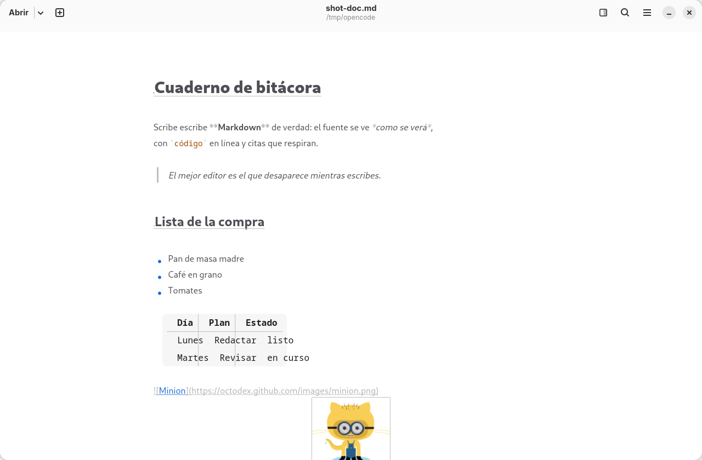
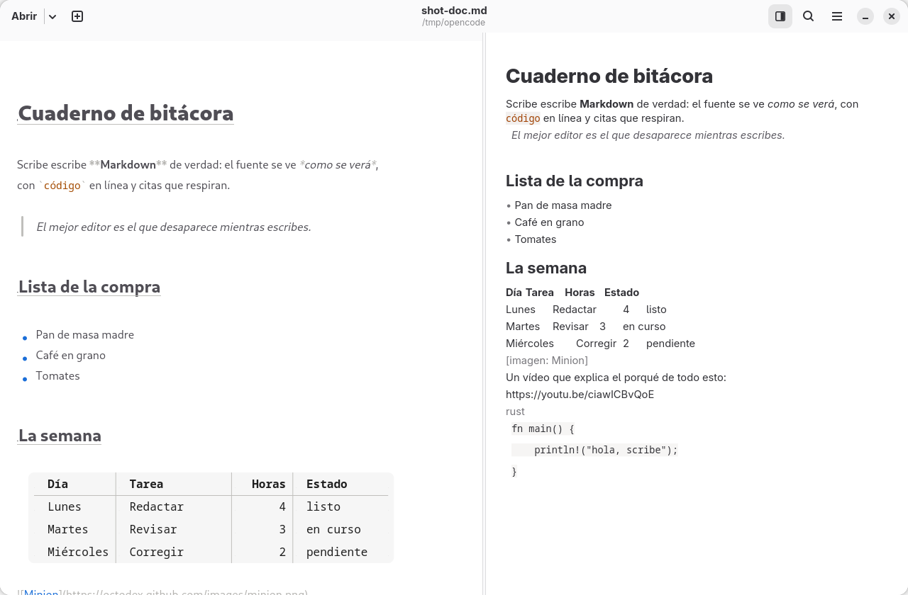
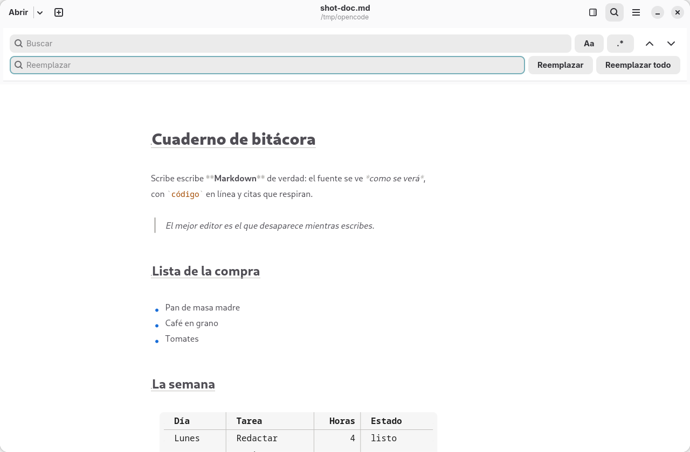
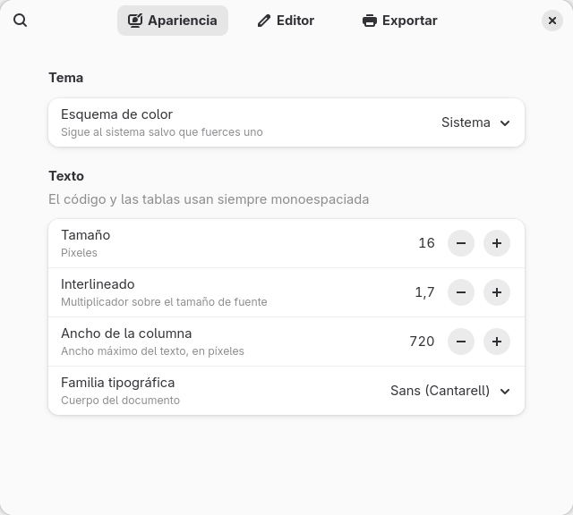
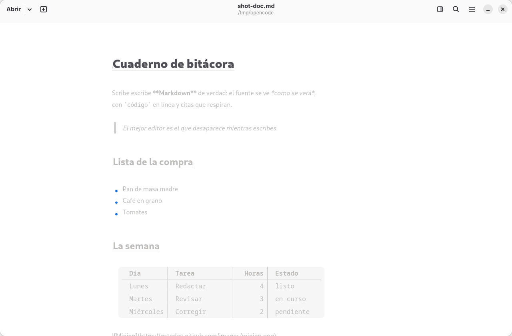

# Scribe

<p align="center">
  <a href="README.es.md">Español</a> |
  <a href="README.md">English</a>
</p>

<p align="center">
  <a href="https://github.com/gnacho/scribe/releases"></a>
  <a href="LICENSE"></a>
</p>

<p align="center">
  <picture>
    <source media="(prefers-color-scheme: dark)" srcset="assets/hero-es-dark.png">
    <source media="(prefers-color-scheme: light)" srcset="assets/hero-es-light.png">
    
  </picture>
</p>

Scribe es un editor Markdown nativo para GNOME, escrito en Rust con GTK4 y
libadwaita. El Markdown se renderiza en vivo sobre el propio buffer de edición:
las cabeceras se ven con su tamaño, la negrita en negrita y las marcas de
sintaxis se atenúan o encogen, sin cambiar a una previsualización aparte ni
usar un motor de navegador.

## Por qué existe esto

Quería un editor Markdown que se sintiera parte de GNOME, no un porte de una
aplicación web. Los que probé o bien metían un motor de navegador (ProseMirror,
Milkdown dentro de WebKit) y consumían cientos de megabytes, o mostraban el
código fuente a un lado y la previsualización al otro. Acababa con los dos
paneles abiertos, yendo y viniendo entre ellos en vez de escribir.

La idea es un editor donde el texto fuente ES la previsualización: el buffer
sigue siendo Markdown sin más, pero el renderizado se pinta encima con
`GtkTextTag`. Así no hay nada que sincronizar, no hay HTML por debajo ni que
empaquetar un motor de navegador. Empezó como maquetas para explorar el diseño
con GTK4 y ha terminado siendo algo que uso de verdad para borradores y notas.

## Por qué este stack

- **Rust + GTK4 + libadwaita** &mdash; toolkit nativo, sin Electron. El binario
  ocupa unos 8 MB y en reposo consume unas docenas de megabytes de RAM. Un
  editor basado en WebKit pesaría diez veces eso antes de abrir un archivo.
- **GtkSourceView 5** para el buffer de texto y **pulldown-cmark** para parsear
  Markdown. Luego se aplican tramos con `GtkTextTag` para el render. Sin HTML
  ni CSS en la previsualización. El editor es un único `GtkTextView` con
  decoraciones sobre el buffer.
- **Sin base de datos, sin servidor, sin JavaScript.** Es una aplicación de
  escritorio que abre, edita y guarda archivos. Las preferencias van por
  GSettings.

## Características

- **Render WYSIWYG en vivo** sobre el buffer de edición: cabeceras a escala
  real, negrita/cursiva/tachado, código en línea y en bloque, citas, listas,
  enlaces, imágenes, notas al pie, tablas y bloques HTML vía tramos de
  `GtkTextTag`.
- **Vista enriquecida** pintada sobre el buffer (`snapshot_layer`): bloques de
  código con caja redondeada, tablas como rejilla visual (cabecera en negrita,
  separadores de columna pintados y un filete donde estaba la fila de guiones),
  filete bajo H1/H2, barra lateral de citas, viñetas dibujadas por nivel,
  casillas de tarea marcables y reglas horizontales. La marca que sustituye un
  adorno se **encoge** en vez de ocultarse.
- **Imágenes locales en bloque**: cuando un `` está solo en su
  línea y el fichero existe (relativo al documento), se pinta escalado bajo la
  marca (máx. 144 px, límite de 20 MB, caché de 64). Los ficheros ausentes
  muestran un placeholder discreto. El buffer nunca se modifica: no se insertan
  widgets ni caracteres.
- **Imágenes remotas**: cuando el destino es una URL, Scribe pregunta primero su
  tamaño (límite de 20 MB), la descarga y la cachea en disco en
  `~/.cache/scribe/images`, de modo que las siguientes veces se pinta sin salir
  a la red. Una URL que falla deja el placeholder y no se reintenta en cada
  repintado.
- **Tarjetas de YouTube**: un vídeo que está solo en su línea, escrito como
  enlace de Markdown, URL suelta o `<iframe>`, se dibuja bajo la línea como una
  tarjeta 16:9 con su miniatura y un botón de reproducción. La línea sigue
  visible y editable, y no hay reproductor embebido: al pulsar la tarjeta se
  abre el navegador.
- **Ctrl+clic en un enlace** abre el destino con la aplicación predeterminada;
  con Ctrl pulsado encima de uno, el globo de ayuda dice a dónde va. Solo se
  ofrecen `http`, `https` y `mailto`, así que un clic normal sigue siendo un
  clic de texto (cursor, selección) cuando no hay nada que abrir.
- **Visibilidad del marcado configurable**: atenuar las marcas de sintaxis
  (`**`, `#`, backticks) siempre, ocultarlas o revelarlas en la línea del
  cursor. Por un bug de GTK
  ([gtk#8346](https://gitlab.gnome.org/GNOME/gtk/-/issues/8346)), "ocultar"
  actualmente *encoge* las marcas (escala ~0) en vez de quitarlas; cuando GTK
  publique el fix, el ocultado real vuelve solo.
- **Modo foco** (Ctrl+Shift+F) atenúa todo salvo el párrafo actual.
- **Máquina de escribir** (Ctrl+Shift+T) mantiene el cursor centrado
  verticalmente.
- **Vista dividida a la derecha** (Ctrl+Shift+P o el icono de la cabecera) con
  render completo en un panel lateral usando el mismo motor de `GtkTextTag`, de
  modo que puedes seguir el índice mientras escribes.
- **Buscar en el documento** (Ctrl+F): barra de búsqueda dentro del panel del
  editor, con contador de coincidencias, botones de anterior/siguiente e
  Intro/Mayús+Intro.
- **Ctrl+B/I/K** envuelve la selección en `**`, `*` o backticks.
- **Alinear tablas** (Ctrl+Alt+T) reformatea todas las tablas del documento
  para que las columnas cuadren en el fuente.
- **Continuación de listas**: al pulsar Intro se crea el siguiente elemento y
  se renumeran las listas ordenadas. Dejar un elemento vacío cierra la lista.
- **Zoom** (Ctrl +/&minus;/0).
- **Cabecera** al estilo de GNOME Text Editor: botón de abrir con desplegable
  de recientes, botón de nueva pestaña, título centrado, botón de vista
  dividida y menú principal.
- **Preferencias** en tres páginas: Apariencia, Editor y Exportación.
- **Exportar a PDF** (Ctrl+P): imprime o exporta el documento a través del
  pipeline de impresión de GTK, reutilizando el mismo análisis de tramos y
  adornos del editor. Las cabeceras, los bloques de código, las citas y las
  tablas se tematizan, con ajustes de exportación separados (esquema de color,
  fuentes, tamaño de página y orientación) y una paginación cuidadosa (sin
  cabeceras huérfanas, soporte de `\newpage`).
- **Archivos**: abrir, guardar y guardar como con `GtkFileDialog`, escritura
  atómica, aviso de cambios sin guardar y autoguardado configurable.
- **Barra lateral** (F9) con documentos recientes filtrables e índice del
  documento navegable.
- **Tema claro y oscuro** que sigue el style scheme de GtkSourceView; las
  Preferencias eligen el esquema de color explícitamente (seguir el sistema,
  claro, oscuro).
- **Integración**: `scribe fichero.md` y "Abrir con" del gestor de archivos.
- **Interfaz traducida** (gettext): inglés y español. Nuevas traducciones en
  `po/` (ver `po/update-pot.sh`).

## Cómo funciona el render

Dos módulos, ninguno con tipos de la aplicación dentro:

- **`src/markdown_render.rs`** analiza el Markdown con pulldown-cmark y
  devuelve dos listas: *tramos* (rangos en bytes con el nombre del
  `GtkTextTag`) y *adornos* (elementos referidos a número de línea que hay que
  pintar). No depende de GTK y se prueba sin display.
- **`src/markdown_view.rs`** es un `GtkSourceView` subclaseado que implementa
  `snapshot_layer`, el vfunc que GTK expone para pintar debajo o encima del
  texto. Trabaja en coordenadas de buffer (GTK resuelve el desplazamiento) y
  dibuja con `gsk::PathBuilder`.

Las marcas que sustituye un adorno (viñetas, `[x]`, `---`, `>`, vallas, pipes)
se encogen en vez de ocultarse: el glifo diminuto sigue en la maquetación de
GTK, así que el camino del aborto por texto invisible de GNOME/gtk#8346 queda
inalcanzable por construcción.

## Limitaciones

- **Solo UTF-8.** Los ficheros se leen como UTF-8 y se escriben de vuelta byte
  a byte. Un fichero en otra codificación (Latin-1, UTF-16, etc.) no se abre.
- **El fuente es la previsualización.** El render es un conjunto de tramos
  `GtkTextTag` y adornos pintados sobre el buffer, no un motor de maquetación.
  El HTML del fuente no se interpreta: queda como texto atenuado en el editor y
  se descarta en la vista dividida. El resultado es una aproximación del
  Markdown, no una copia del render de un navegador.
- **Sin reemplazar, sin exportar a HTML y sin corrección ortográfica.** La
  barra de buscar (Ctrl+F) busca en el documento activo; el reemplazo no está
  implementado.
- **La exportación a PDF no lleva índice ni marcadores.** `GtkPrintOperation`
  no expone marcadores de PDF, así que el PDF exportado no tiene tabla de
  contenidos ni outline.
- **Imágenes**: los ficheros locales de hasta 20 MB se pintan, como máximo
  144 px de alto, y las URLs remotas se descargan con los mismos límites. Las
  imágenes inline (no solas en su línea), los ficheros ausentes y las descargas
  que fallan muestran el placeholder.
- **La caché de imágenes no caduca.** Una imagen editada en disco no se
  refresca hasta reabrir el documento, y la descargada se reutiliza desde
  `~/.cache/scribe/images` hasta que borres ese directorio.
- **Los vídeos no se reproducen dentro del editor.** La tarjeta se dibuja a
  partir del id del vídeo y de una miniatura que se pide a `i.ytimg.com`, y al
  pulsarla se abre el navegador. Un enlace cuyo id no sea un id válido de 11
  caracteres se queda como texto.
- En el modo «ocultar / revelar en la línea del cursor» las marcas se encogen,
  no se quitan (ver arriba).

## Privacidad

Scribe no recopila nada y no tiene cuentas, telemetría ni nube. Las únicas
peticiones que hace son las que le pide un documento: las imágenes remotas y las
miniaturas de vídeo referenciadas por el texto se descargan para pintarlas y se
cachean en `~/.cache/scribe/images`. Nunca se sube nada. Ver
[PRIVACY.md](PRIVACY.md).

## Capturas

**Ventana principal con render Markdown en vivo**

<picture>
  <source media="(prefers-color-scheme: dark)" srcset="assets/hero-es-dark.png">
  <source media="(prefers-color-scheme: light)" srcset="assets/hero-es-light.png">
  
</picture>

**Vista dividida (con el icono de la cabecera) y buscar en el documento**

<p align="center">
  
</p>

<p align="center">
  
</p>

**Ventana de preferencias**

<p align="center">
  
</p>

**Modo foco (todo atenuado salvo el párrafo actual)**

<p align="center">
  
</p>

## Requisitos de compilación

- Rust 1.85 o superior
- GTK4 (&ge; 4.14), libadwaita (&ge; 1.5), GtkSourceView 5 y GLib con sus
  ficheros de desarrollo

Arch / CachyOS:

```sh
sudo pacman -S rust gtk4 libadwaita gtksourceview5 glib2
```

Debian / Ubuntu:

```sh
sudo apt install libgtk-4-dev libadwaita-1-dev libgtksourceview-5-dev libglib2.0-dev
```

Fedora:

```sh
sudo dnf install gtk4-devel libadwaita-devel gtksourceview5-devel glib2-devel
```

## Instalar

Instala en `~/.local` (sin root) con:

```sh
make install
```

Esto compila el binario en modo release e instala el binario en `~/.local/bin`,
el esquema GSettings en `~/.local/share/glib-2.0/schemas` (recompilado con
`glib-compile-schemas`), el fichero .desktop y los iconos. `make build` compila
en modo release y `make check` ejecuta fmt, clippy y los tests.

El esquema GSettings es obligatorio, no opcional: cuando una versión añade una
preferencia nueva, la aplicación aborta si el esquema instalado está
desactualizado (ya no contiene la clave nueva). `make install` lo recompila
para que eso no ocurra.

## Compilar y ejecutar

```sh
cargo build --release
cargo run
```

En desarrollo puedes apuntar al esquema local en vez de instalarlo:

```sh
glib-compile-schemas data/
GSETTINGS_SCHEMA_DIR=$PWD/data cargo run
```

Si el esquema no está disponible, la aplicación arranca igual con los valores
por defecto (no guarda preferencias) y avisa por stderr.

## Flatpak

Hay un manifiesto en [build-aux/flatpak](build-aux/flatpak) dirigido al runtime
GNOME 50. `cargo-sources.json` se genera con
[flatpak-cargo-generator](https://github.com/flatpak/flatpak-builder-tools/tree/master/cargo)
y `Cargo.lock` está commiteado:

```sh
cargo generate-lockfile
python3 flatpak-cargo-generator.py Cargo.lock -o build-aux/flatpak/cargo-sources.json
cd build-aux/flatpak
flatpak-builder --user --install build-dir app.scribe.Scribe.json --force-clean
```

## Desarrollo

```sh
git clone https://github.com/gnacho/scribe.git
cd scribe
cargo build
cargo test
cargo run
```

## Licencia

AGPL-3.0-or-later. Ver [LICENSE](LICENSE).
