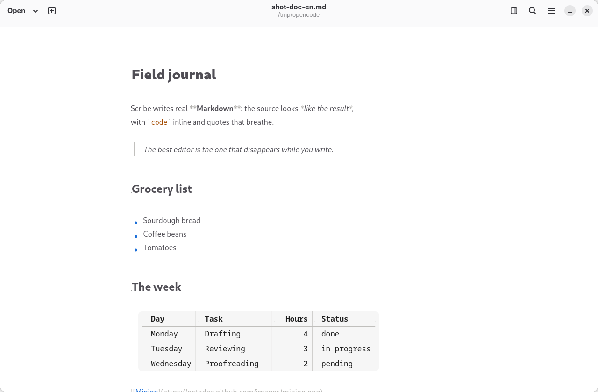
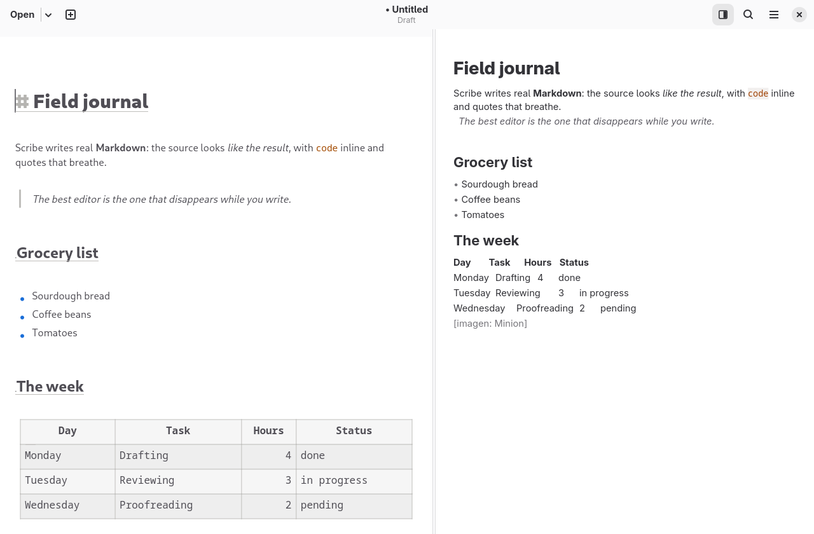
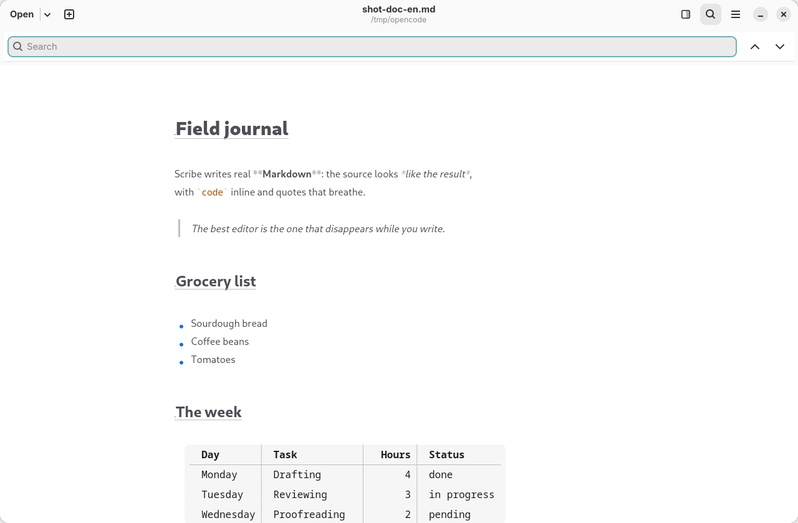
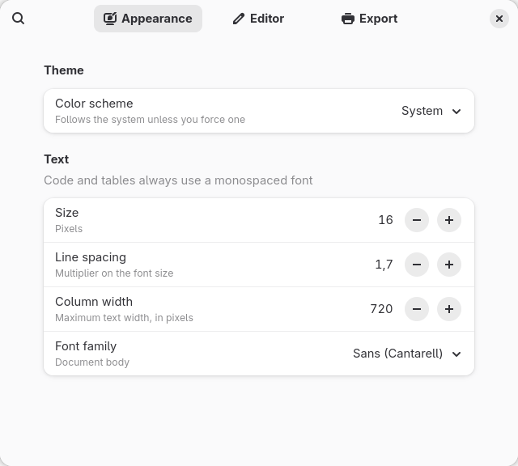
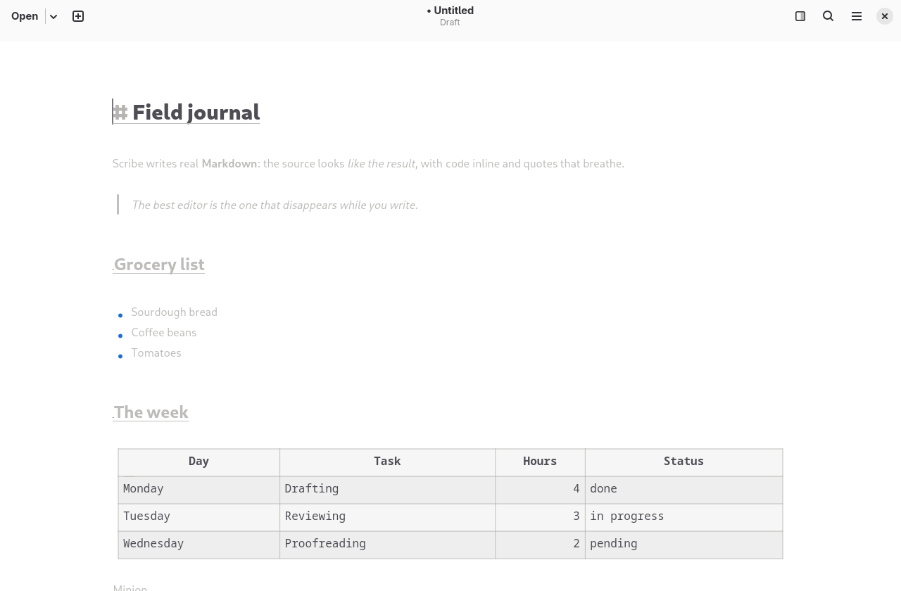

# Scribe

<p align="center">
  <a href="README.md">English</a> |
  <a href="README.es.md">Español</a>
</p>

<p align="center">
  <a href="https://github.com/gnacho/scribe/releases"></a>
  <a href="LICENSE"></a>
</p>

<p align="center">
  <picture>
    <source media="(prefers-color-scheme: dark)" srcset="assets/hero-en-dark.png">
    <source media="(prefers-color-scheme: light)" srcset="assets/hero-en-light.png">
    
  </picture>
</p>

Scribe is a native GNOME Markdown editor that renders your document as you type — no preview switch, one surface. Built with Rust, GTK 4 and libadwaita.
It renders Markdown live on the editing buffer so headings look like headings
and bold text looks bold, without switching to a separate preview or a browser
engine.

See it in action at [scribe.cloudless.club](https://scribe.cloudless.club): every
feature working, screenshots in light and dark, a live typing demo and install
instructions for .deb, .rpm, AppImage and AUR.

## Why does this exist?

I wanted a Markdown editor that felt like part of GNOME, not a port of a web
app. The ones I tried either wrapped a browser engine (ProseMirror, Milkdown
inside WebKit) and consumed hundreds of megabytes, or showed a plain source
buffer next to a rendered preview. I kept both panes open, going back and forth
between them instead of just writing.

The idea is an editor where the source text IS the preview: the buffer stays
plain Markdown, but the rendering happens on top with `GtkTextTag`. There is
nothing to sync, no HTML under the hood, no browser engine to bundle. It
started as mockups for a GTK4 design exploration and evolved into something I
actually use to draft notes and docs.

## Why this stack?

- **Rust + GTK4 + libadwaita** &mdash; native toolkit, no Electron. The binary
  is around 8 MB and idles at a few dozen megabytes of RAM. A WebKit-based
  editor would be ten times that before opening a file.
- **GtkSourceView 5** for the text buffer and **pulldown-cmark** for Markdown
  parsing, then custom `GtkTextTag` spans for rendering. No HTML or CSS in the
  preview. The editor is a single `GtkTextView` with decorations applied to the
  buffer.
- **No database, no server, no JavaScript.** It is a desktop application that
  opens, edits and saves files. Preferences go through GSettings.

## Features

- **Live WYSIWYG rendering** on the editing buffer: headings at real scale,
  bold/italic/strikethrough, inline and fenced code, quotes, links, images,
  footnotes, tables and HTML blocks via `GtkTextTag` spans.
- **Rich rendered view** on top of the buffer (`snapshot_layer`): rounded code
  blocks, tables as a visual grid (bold header, painted column separators and a
  rule where the delimiter row was), a rule under H1/H2, vertical quote bars,
  drawn bullets per nesting level, checkable task boxes and horizontal rules.
  The mark a decoration replaces is **shrunk** instead of hidden.
- **Spell checking**: misspelt words are underlined as you type, with
  suggestions and "ignore/add to dictionary" in the context menu; the language
  follows the system locale and it can be switched off in Preferences.
- **Tables of prose as real tables**: when a table's prose cells cannot fit
  its delimiter geometry (the common long-form table), the source rows collapse
  and the table is painted as a canvas: every cell wraps within its column,
  the header is bold with a rule, and alignments are honoured. The row under
  the cursor shows its raw source for editing.
- **Local images in block**: when an `` is alone on its line and
  the file exists (relative to the document), it is painted scaled below the
  mark (max 144 px, 20 MB limit, cache of 64). Missing files show a discreet
  placeholder. The buffer is never modified: no widgets, no characters
  inserted.
- **Remote images**: when the destination is a URL, Scribe asks for its size
  first (20 MB limit), downloads it and caches it on disk under
  `~/.cache/scribe/images`, so later runs paint it without going out again. A
  URL that fails keeps the placeholder and is not retried on every redraw.
- **YouTube cards**: a video that is alone on its line, written as a Markdown
  link, a bare URL or an `<iframe>`, is drawn below the line as a 16:9 card
  with its thumbnail and a play badge. The line stays visible and editable, and
  there is no embedded player: clicking the card opens your browser.
- **Ctrl+click a link** opens the destination with the default application;
  holding Ctrl over one shows where it goes. Only `http`, `https` and `mailto`
  are offered, so the click stays a text click (cursor, selection) when there is
  nothing to open.
- **Configurable markup visibility**: dim the syntax markers (`**`, `#`,
  backticks) everywhere, hide them, or reveal them on the cursor line. Because
  of a GTK bug ([gtk#8346](https://gitlab.gnome.org/GNOME/gtk/-/issues/8346)),
  "hide" currently *shrinks* the marks (scale ~0) instead of removing them;
  when GTK ships the fix, real hiding returns on its own.
- **Focus mode** (Ctrl+Shift+F) dims everything except the current paragraph.
- **Typewriter mode** (Ctrl+Shift+T) keeps the cursor vertically centered.
- **Split preview on the right** (Ctrl+Shift+P, or the header icon) renders the
  full document in a side panel using the same `GtkTextTag` engine, so you can
  keep an eye on the outline while you write.
- **Find in the document** (Ctrl+F): a search bar inside the editor pane, with a
  match counter, next/previous buttons and Enter/Shift+Enter.
- **Ctrl+B/I/K** wraps the selection in `**`, `*` or backticks.
- **Align tables** (Ctrl+Alt+T) reformats all tables in the document so their
  columns line up in the source.
- **List continuation**: pressing Enter starts the next item and re-numbers
  ordered lists. Leaving an item empty closes the list.
- **Zoom** (Ctrl +/&minus;/0).
- **Header bar** follows GNOME Text Editor: open button with recent files
  dropdown, new tab button, centered title, split preview toggle and main menu.
- **Preferences** window with three pages: Appearance, Editor and Export.
- **Export to PDF** (Ctrl+P): print or export the document through the GTK
  print pipeline, reusing the same span/ornament analysis as the editor.
  Headings, code blocks, quotes and tables are themed, with separate export
  settings (color scheme, fonts, page size and orientation) and careful
  pagination (no orphan headings, `\newpage` support).
- **Page templates** (Custom, Article, Manuscript, Letter, Compact) group
  margins, body and code typography, line spacing, heading scale, header and
  footer and an optional title block. The same template feeds both the exported
  file and the preview, so what you see is what prints.
- **Print preview** (menu, next to Export to PDF) renders the real pages through
  the export pipeline before committing to paper or a file.
- **Your own stylesheet**: an optional CSS file applies on top of the chosen
  template (see [Stylesheets](#stylesheets)).
- **Files**: open, save and save-as with `GtkFileDialog`, atomic writes,
  unsaved-changes warning, configurable autosave.
- **Sidebar** (F9) with filterable recent files and a navigable outline.
- **Light and dark theme** follows the GtkSourceView style scheme; the
  Preferences pick the colour scheme explicitly (follow system, light, dark).
- **Integration**: `scribe file.md` and "Open with" from the file manager.
- **Translated UI** (gettext): English and Spanish. New translations go in
  `po/` (see `po/update-pot.sh`).

## How the rendering works

Two modules, neither depending on application types:

- **`src/markdown_render.rs`** parses Markdown with pulldown-cmark and returns
  two lists: *spans* (byte ranges with a `GtkTextTag` name) and *ornaments*
  (elements keyed by line number to be painted). GTK-independent, unit-tested
  without a display.
- **`src/markdown_view.rs`** is a `GtkSourceView` subclass that implements
  `snapshot_layer`, the vfunc GTK exposes for drawing below or above text. It
  works in buffer coordinates (GTK handles scrolling) and draws with
  `gsk::PathBuilder`.

Markers replaced by an ornament (bullets, `[x]`, `---`, `>`, fences, pipes) are
shrunk rather than hidden: the tiny glyph stays in GTK's layout, so the
invisible-text abort path of GNOME/gtk#8346 is unreachable by construction.

## Stylesheets

`Preferences > Export > Stylesheet` loads a CSS file that is applied on top of
the page template. It is a mapped subset, not a CSS engine: the export paints
and paginates with cairo, so each declaration is translated into a value the
layout already understands, and anything outside this table is ignored (the
export warns once and keeps going).

| Selector | Properties |
| --- | --- |
| `@page` | `margin`, `margin-top`, `margin-right`, `margin-bottom`, `margin-left` (`pt`, `mm`, `cm`, `in`, `px`) |
| `body`, `html`, `:root` | `font-family`, `font-size`, `line-height`, `color`, `background-color`, `margin-bottom`, `--block-spacing` |
| `p` | `line-height`, `color`, `margin-bottom`, `--block-spacing` |
| `h1` to `h4` | `font-size`, `color` |
| `pre`, `code` | `font-family`, `color`, `background-color` |
| `blockquote`, `a`, `table` | `color`, plus `background-color` on `table` |

When the sheet says nothing about a value, the template keeps its own, and
removing the file restores the previous output exactly. Example:

```css
@page { margin: 2cm 2.5cm }
body {
  font-family: "Source Serif 4", serif;
  font-size: 11pt;
  line-height: 1.6;
  color: #1a1a1a;
  --block-spacing: 8pt;
}
h1 { font-size: 20pt; color: #003366 }
pre { background-color: #f5f5f5 }
```

## Limitations

- **UTF-8 only.** Files are read as UTF-8 and written back byte for byte. A
  file in another encoding (Latin-1, UTF-16, and so on) does not open.
- **The source is the preview.** Rendering is a set of `GtkTextTag` spans and
  painted ornaments over the buffer, not a layout engine. HTML in the source is
  not interpreted: it stays as dimmed text in the editor and is dropped in the
  split preview. The result is an approximation of the Markdown, not a copy of
  a browser rendering.
- **No export to HTML, and no spell checking.** The find bar (Ctrl+F)
  searches the active document, with case sensitivity and regular expressions as
  options. Ctrl+H reveals a second row with Replace and Replace All, so the
  replacement is done in place, not in a dialog.
- **PDF export has no outline/bookmarks.** `GtkPrintOperation` does not expose
  PDF bookmarks, so the exported PDF carries no table of contents or outline.
- **Images**: local files up to 20 MB are painted, at most 144 px tall, and
  remote URLs are downloaded with the same limits. Inline images (not alone on
  their line), missing files and downloads that fail show the placeholder.
- **The image cache has no expiry.** A picture edited on disk is not refreshed
  until the document is reopened, and a downloaded one is reused from
  `~/.cache/scribe/images` until you delete that directory.
- **Videos are not played inside the editor.** The card is drawn from the video
  id and a thumbnail fetched from `i.ytimg.com`, and clicking it opens the
  browser. A link whose id is not a valid 11-character id is left as text.
- In "hide" mode the marks are concealed per element, Obsidian-style: the
  markers around the element the cursor is in (or touching) reveal; the rest
  stay shrunk. Heading, list and quote markers reveal on their line instead.
  Marks are shrunk, not removed (see above).

## Privacy

Scribe collects nothing and has no accounts, telemetry or cloud. The only
requests it makes are the ones a document asks for: remote images and video
thumbnails referenced by the text are downloaded to be painted and cached under
`~/.cache/scribe/images`. Nothing is ever uploaded. See
[PRIVACY.md](PRIVACY.md).

## Screenshots

**Main window with live Markdown rendering**

<picture>
  <source media="(prefers-color-scheme: dark)" srcset="assets/hero-en-dark.png">
  <source media="(prefers-color-scheme: light)" srcset="assets/hero-en-light.png">
  
</picture>

**Split preview (toggled from the header icon) and find in the document**

<p align="center">
  
</p>

<p align="center">
  
</p>

**Preferences window**

<p align="center">
  
</p>

**Focus mode (everything dimmed except the current paragraph)**

<p align="center">
  
</p>

## Build requirements

- Rust 1.85 or later
- GTK4 (&ge; 4.14), libadwaita (&ge; 1.5), GtkSourceView 5 and GLib
  development files

Arch / CachyOS:

```sh
sudo pacman -S rust gtk4 libadwaita gtksourceview5 glib2
```

Debian / Ubuntu:

```sh
sudo apt install libgtk-4-dev libadwaita-1-dev libgtksourceview-5-dev libenchant-2-dev libglib2.0-dev
```

Fedora:

```sh
sudo dnf install gtk4-devel libadwaita-devel gtksourceview5-devel enchant2-devel glib2-devel
```

## Install

Install to `~/.local` (no root) with:

```sh
make install
```

This builds the release binary and installs the binary to `~/.local/bin`, the
GSettings schema to `~/.local/share/glib-2.0/schemas` (recompiled with
`glib-compile-schemas`), the desktop entry and the icons. `make build` compiles
in release mode and `make check` runs fmt, clippy and the tests.

The GSettings schema is mandatory, not optional: when a release adds a new
preference, the app aborts if the installed schema is stale (it no longer
contains the new key). `make install` recompiles it so that does not happen.

## Build and run

```sh
cargo build --release
cargo run
```

For development you can point at the local schema instead of installing it:

```sh
glib-compile-schemas data/
GSETTINGS_SCHEMA_DIR=$PWD/data cargo run
```

If the schema is not found at all, the app starts with defaults (preferences
are not saved) and logs a warning to stderr.

## Flatpak

Two manifests target the GNOME 51 runtime: [packaging/flatpak](packaging/flatpak)
builds from a pinned git commit and is the one submitted to Flathub, while
[build-aux/flatpak](build-aux/flatpak) builds the local checkout. Both are YAML
and both read the same `cargo-sources.json`, generated with
[flatpak-cargo-generator](https://github.com/flatpak/flatpak-builder-tools/tree/master/cargo)
from the committed `Cargo.lock`. The canonical copy lives in
`packaging/flatpak/`; the one in `build-aux/flatpak/` is a symlink to it:

```sh
cargo generate-lockfile
python3 flatpak-cargo-generator.py Cargo.lock -o packaging/flatpak/cargo-sources.json
cd build-aux/flatpak
flatpak-builder --user --install build-dir io.github.gnacho.Scribe.yml --force-clean
```

## Development

```sh
git clone https://github.com/gnacho/scribe.git
cd scribe
cargo build
cargo test
cargo run
```

## License

AGPL-3.0-or-later. See [LICENSE](LICENSE).
